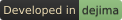

<!-- Fixed, not preference-aware, and that is the decision rather than an
     oversight. `prefers-color-scheme` reports the browser's setting, never the
     site's, and this is read on a forge that renders dark whichever way the
     browser is set - so anything conditional shows dark ink on a dark page to
     a reader whose browser prefers light, and does it silently.
     The suffix names the mode a file is FOR, not the colour of its ink:
     -darkmode is the pale wordmark that belongs on a dark page. A mirror on a
     light-themed host swaps the filename below for dejima-wordmark-lightmode.png,
     which is committed alongside for exactly that. One line, on the mirror,
     where someone can see whether it worked.
     Every &nbsp; here is spacing, and it has to be a character rather than CSS
     or a presentation attribute. Gitea's sanitizer strips `style` from the tag
     and from any wrapper, `hspace`/`vspace` survive sanitizing only to be
     ignored by browsers that dropped HTML4 presentation attributes, and a bare
     <br> ends a line nothing follows, which browsers collapse to no height.
     &nbsp; survives as a real U+00A0: on its own line it fills a paragraph
     that would otherwise be empty, and immediately before the tag it sits
     inline and indents the image by one space. -->
&nbsp;

&nbsp;

---

&nbsp;

# Devbox Hardener

Bounds what a compromised development VM can reach on your network, and tells
you what that bound actually is.

A devbox is a long-lived VM that runs [dejima](https://gitbox.branderson.io/dejima/dejima)
sessions. Unlike a CI runner it holds uncommitted work, so it cannot be rolled
back on a schedule — and rollback is the whole containment story of the sister
project, [dejima-ci-hardener](https://gitbox.branderson.io/dejima/dejima-ci-hardener).
What replaces it is the hypervisor firewall, plus knowing precisely what sits
inside it.

**It does not prevent root on the devbox.** Nothing here tries to. It makes root
reach less, and makes that reach something you can check rather than assume.

| | |
| --- | --- |
| [proxmox/README.md](proxmox/README.md) | **Start here.** The node side: create the VM, apply the firewall. Everything in the web console |
| [docs/building-a-devbox.md](docs/building-a-devbox.md) | The guest side: install, bootstrap, verify. The same on any hypervisor |
| [docs/threat-model.md](docs/threat-model.md) | What each layer grants, what was [rejected and why](docs/threat-model.md#rejected-with-reasons), and [what is not bounded](docs/threat-model.md#not-bounded) |

Do the node side first, through the end of its §3.

[](https://gitbox.branderson.io/dejima/dejima)

---

## Before you use it

**Early development. Not ready to be depended on.** Nothing here has been
through outside review, an external audit, or adversarial testing by anyone but
the person who wrote it. Every security property this describes is a claim
awaiting scrutiny, not one that has survived it. Do not put this anywhere that
being wrong about it would matter.

**One maintainer, no support.** Nothing about this is promised: not a reply, not
a fix, not a release. [SECURITY.md](SECURITY.md) has the detail, and is where to
report a vulnerability rather than in a public issue.

**One person's work per devbox.** A condition of the tool rather than an
observation about how devboxes get used: the blast radius here is stated in
terms of what is on the box, so a machine holding several people's work is out
of spec and
[the reasoning](docs/threat-model.md#what-this-tool-assumes) does not hold for
it. If you need separation between people, use a devbox each.

**Container escape is deliberately deprioritised.** An escape gains root, which
is more than the container has — and root on this VM is already a row in the
[blast radius table](docs/threat-model.md#blast-radius-by-layer), bounded by the
same hypervisor firewall however it was reached. So
[patching is what is left worth doing](docs/threat-model.md#why-container-escape-is-deprioritised),
and separating escape from root inside the guest is not.

## Use

```sh
sudo ./bin/dejima-devbox-bootstrap    # once, in the guest
cd ~/dejima && ./install.sh           # dejima's own step, as your own account

sudo dejima-devbox-audit              # both halves
sudo dejima-devbox-audit reach        # containment only, what the timer runs
sudo dejima-devbox-audit radius       # what root here would get

./bin/dejima-devbox-upgrade status    # what this box is missing, from a checkout
```

Bootstrap installs what dejima needs from the host - Docker with the `compose`
v2 plugin, `python3`, `jq` - and clones dejima to `~/dejima`. It stops there.
Installing dejima is dejima's step: `install.sh` writes into your `~/.claude`,
`~/.local/bin` and `~/.config/dejima`, and what it does there is that project's
to define and to change. A copy of that contract kept here would go stale
without anything noticing.

The audit needs root. The config is `0640 root`, and the radius report stats
files in the home of the account that runs dejima, which it reads from the
config rather than from `$HOME` - under `sudo` and under the timer that is
root's, whose home on a devbox holds nothing.

## How it fails

**The firewall is on the hypervisor, so the guest cannot verify it by reading
it.** That is what makes it worth having and what makes checking it awkward. The
audit tests behaviour instead, by probing the default gateway: already in the
routing table so it reveals nothing, guaranteed alive where an arbitrary address
is not, and inside the ranges the firewall drops.

**A timeout has two causes**, and telling them apart is the whole design:

| | |
| --- | --- |
| `PASS` | Nothing answered **and** the network demonstrably works |
| `FAIL` | Something answered. Rules missing, or an exception above them |
| `INDETERMINATE` | Nothing answered, including things that should. **Not a pass.** |

A check that reports success when it does not know is worse than no check,
because it gets believed.

**The IPv6 half has the same three states for different reasons.** It asks the
segment who is there over IPv6 and counts the answers, and there a silence is
unambiguous: the node dropped the family, or the guest never had it, and both
are the outcome wanted. So silence is a plain `PASS` with no positive control.
`INDETERMINATE` is reserved for the probe not running at all, which is still not
a pass. It is a separate check because the node's other rules name IPv4 ranges
and match none of that traffic - see
[the LAN boundary is two boundaries](docs/threat-model.md#the-lan-boundary-is-two-boundaries).

**A rule that REJECTs rather than DROPs reports `FAIL` even though it is
working.** `bash`'s `/dev/tcp` cannot tell a rejection from a live host
refusing. That is the safe direction to be wrong in, and it is why the template
specifies DROP.

**Nothing is stored about what this VM must not reach.** Such a list would be a
map of valuable targets, kept on the machine this project assumes will be owned.
The audit derives its targets from the routing table and its controls from your
forge, so there is nothing to type and nothing to leak.

## Versions, and the boxes already out there

`VERSION` is what this checkout ships; `/etc/dejima-devbox/state` is what a
given devbox is at. **Two numbers**, because the guest half is installed from a
checkout and the node half is typed into a console, and only one of them is
knowable from inside the VM.

dejima needs none of this — short-lived containers, tip of `main` only, `git
pull` closes any gap. A devbox is pinned to the day it was built, and a snapshot
restore can move it backwards without anyone deciding to.
[docs/upgrading.md](docs/upgrading.md) is the process; [upgrades/](upgrades/) is
one note per version, written for someone at a console who has not read the diff.

```sh
./bin/dejima-devbox-upgrade status    # run from a checkout, not the installed copy
```

## Tests

```sh
bats test/
```

`test/devbox.bats` asserts against a real devbox and skips everywhere else. It
is gated on `DEJIMA_DEVBOX=1` rather than on detecting a devbox, because a
detector that guesses wrong skips silently, and a suite that passes by asserting
nothing is worse than one that fails.

## Further reading

| | |
| --- | --- |
| [docs/](docs/) | Index of everything below |
| [docs/threat-model.md](docs/threat-model.md) | What each layer grants, why escape is deprioritised, what was rejected |
| [docs/reference.md](docs/reference.md) | The three verdicts, the three addressing modes, the one config key |
| [SECURITY.md](SECURITY.md) | What this claims, and where to report a vulnerability |
| [dejima-ci-hardener](https://gitbox.branderson.io/dejima/dejima-ci-hardener) | The sister project, for hosts that *can* be rolled back |

## License

GPL-3.0-or-later. See [LICENSE](LICENSE).

The dejima wordmark and logo are not code and are not covered by that licence.
They are trademarks; who holds them and what may be done with them is stated
once for the organisation, at
[dejima's ATTRIBUTION.md](https://gitbox.branderson.io/dejima/dejima/src/branch/main/ATTRIBUTION.md).
